<!-- animated contribution graph: real data, boxes reveal cell by cell
     (regenerated daily by .github/workflows/update-profile-art.yml) -->

<h3><code>NazZqi@github ~ $ ./contributions.sh</code></h3>

 
 

<!-- ascii portrait (left) + streak/numbers card (right). both svgs are
     840x880 so equal widths give equal heights.
     portrait: python scripts/prep_photo.py <dp.png> && python scripts/make_ascii_svg.py
     stats:    python scripts/render_stats_svg.py (same daily workflow) -->

<h3><code>NazZqi@github ~ $ whoami</code></h3>

<table>
<tr>
<td valign="top"></td>
<td valign="top"></td>
</tr>
</table>
 
 

<h3><code>NazZqi@github ~ $ ./links.sh</code></h3>

<b>Junior Fullstack · Backend · Computer Engineering Student </b>

 

---

## 👋 Hola, soy Ignacio (Nazdev)

💻 Estudiante avanzado de Ingeniería Civil Informática · Universidad de Valparaíso
⚙️ Desarrollador Junior Backend & Full Stack

---

## 🚀 Sobre mí
Tengo base sólida en algoritmos, estructuras de datos y programación orientada a objetos. Vengo de soporte técnico universitario (DTIC UV), donde aprendí autonomía, priorización y comunicación asíncrona. Busco roles backend o fullstack en startups y equipos remotos.

---

## 📌 En lo que estoy ahora
- 💰 Construyendo **FinanSY**: app para ahorrar con amigos (Rust, Axum, PostgreSQL)
- 🧱 Profundizando en backend y arquitectura de software
- 🤖 Usando IA y Copilot como apoyo de desarrollo

---

## 🛠 Tecnologías

**Metodologías:** Scrum · Agile · Cascada (Waterfall)

**IA:** GitHub Copilot · LLMs

---

## 📂 Proyectos destacados
**[FinanSY](https://github.com/NazZqi/FinanSY)** · Rust · PostgreSQL · HTMX
App web para ahorrar en grupo hacia una meta común: aportes, ranking, rachas, retos y simulador de ahorro frente a compra en cuotas. Backend en Rust (Axum), PostgreSQL en Supabase, login con Google, pruebas automatizadas y CI.

**[Ruteando](https://github.com/NazZqi/pruebas-ruteando)** · Flutter · Firebase · Google Maps
App móvil para optimizar rutas de reparto de última milla. Proyecto universitario en equipo con Scrum.

**[Visión Asistida](https://github.com/NazZqi/vision_asistida)** · Python · PyTorch · OpenCV
Asistente visual en tiempo real: estima profundidad con MiDaS y detecta obstáculos desde la cámara, con alertas visuales y por voz.

---

## 🎯 Objetivo
Crecer como desarrollador backend/fullstack y aportar en equipos ágiles y remotos.

---

## ✨ Un poco de mí
_"El esfuerzo le gana al talento."_
